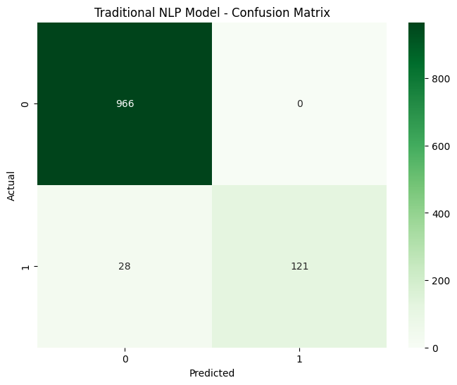
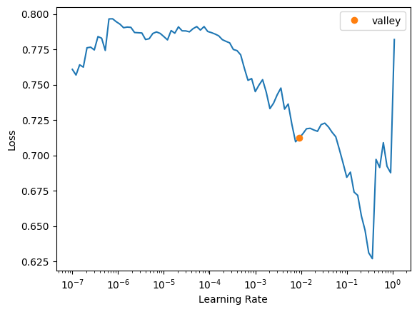

# SMS Spam Detection — Traditional NLP vs Deep Learning

Two ways to catch spam text messages, built on the same 5,572 messages and compared head to head: a classic TF-IDF + logistic regression model, and a deep-learning transfer-learning model (fastai AWD_LSTM). The deep model scores higher — and this README explains why that comparison is only indicative, not a clean win.

From Northeastern's EAI6010 course (instructor Sergiy Shevchenko, Spring 2026). Assignment 3 report completed 8 June 2026; Module 5 microservice report completed 23 June 2026.

## In plain language

Everyone gets spam texts. This project builds two spam filters and tests them on real messages from the UCI SMS Spam Collection:

1. **Traditional NLP:** turn each message into word counts (TF-IDF), then logistic regression.
2. **Deep learning:** a pre-trained language model (AWD_LSTM) fine-tuned on the same messages.

The deep model wins on accuracy (99.21% vs 97.49%). But the two models were evaluated on different-sized test sets, and the report and the notebook disagree on the deep model's exact numbers — so the README shows all of that plainly instead of declaring a simple victory.

## The data

- **UCI SMS Spam Collection v.1** (Almeida & Gómez Hidalgo, 2012): `data/SMSSpamCollection` — **5,572 messages** (4,825 ham, 747 spam, 13.41% spam). The dataset readme says 5,574 total; the file loads as 5,572 — a 2-message difference whose cause was not established, flagged here rather than smoothed.
- 80/20 stratified split, random state 42: train 4,457, validation 1,115.

## Traditional NLP — TF-IDF + Logistic Regression

- TF-IDF: top 3,000 features, 1–2 word phrases, minimum document frequency 2, English stopwords removed. Feature matrix (4457, 3000).
- Logistic regression: max_iter 1000, C=1.0. Training took 0.01 seconds; the whole pipeline 0.06 seconds.
- **Accuracy 0.9749, precision 1.0000, recall 0.8121, F1 0.8963** (validation set, 1,115 messages).
- Per class: ham precision 0.97 / recall 1.00 (966 messages); spam precision 1.00 / recall 0.81 (149 messages). The model never calls a real message spam — but it misses about 19% of actual spam.
- Top spam words by coefficient: txt 4.3902, mobile 3.5444, uk 3.4748, claim 3.3800, www 3.2361, reply 3.1788, 150p 2.9044, free 2.8308, service 2.8300, stop 2.6764.
- Sample tests: "WINNER!!…" → spam; "Hey, are we still meeting for lunch tomorrow?" → ham.
- **The trained model is in this repo:** `spam_model.pkl` (24,722 bytes) and `vectorizer.pkl` (112,215 bytes) — load them and call predict, no retraining needed.

## Deep learning — fastai AWD_LSTM transfer learning

- Pre-trained AWD_LSTM language model, `text_classifier_learner`, drop_mult 0.5, batch size 32, `fine_tune(4, base_lr=1e-2)`.
- **Final validation: accuracy 0.9921, precision 0.9917, recall 0.9520, F1 0.9714** (from the notebook's stored `learn.validate()` outputs).
- Training path: frozen epoch 0 — accuracy 0.9596; fine-tuning epochs 0–3 ending at 0.9921 (epoch 2 peaked at 0.9933, precision 1.0000, recall 0.9520, F1 0.9754).
- Sample tests with confidences: WINNER → spam 0.9776; lunch → ham 0.9732; "FREE entry…" → spam 0.9970.
- Note: the notebook exports `spam_detector_dl.pkl`, but **that file was not found on the Mac** — the deep model is in the notebook only, not as a saved file in this repo.

## The comparison — and why it is only indicative

| Model | Accuracy | Precision | Recall | F1 | Evaluated on |
|---|---|---|---|---|---|
| Traditional (TF-IDF + LR) | 0.9749 | 1.0000 | 0.8121 | 0.8963 | 1,115 messages |
| Deep learning (AWD_LSTM) | 0.9921 | 0.9917 | 0.9520 | 0.9714 | 891 messages |

Two cautions, kept in plain sight:

1. **Different evaluated sets.** The deep model's classification report covers 891 messages (ham 766, spam 125), not the 1,115 the traditional model was evaluated on. The report's claim that both models "used the same data" is contradicted by that support count. The deep model is better on every metric, but the head-to-head is indicative only.
2. **Report vs notebook disagreement.** The Assignment 3 report states the deep model at 98.99% accuracy, recall 92.98%, F1 95.93%. The notebook's stored outputs say 99.21% / 95.20% / 97.14%. This README quotes the notebook (verified stored outputs) and flags the report. The report's traditional numbers do match the notebook.

**Which would you actually ship?** The report's own recommendation is the traditional model — it trains in 0.01 seconds, costs almost nothing to run, is explainable (you can read the top spam words above), and has 100% precision, so it never blocks a real message. The deep model catches more spam (95.20% recall vs 81.21%) but needs a GPU-scale model behind it. That trade-off — accuracy vs speed, cost and explainability — is the real lesson of the comparison.

## Deployed: the spam detector microservice

The traditional model was wrapped in a Flask REST API (endpoints `GET /`, `POST /predict`, `GET /health`) and deployed on Render's free tier: https://spam-detector-api-phqc.onrender.com (first request may take up to 50 seconds on the free tier). The Module 5 report in `reports/` documents it; the Flask source code is not on the Mac, so it is not in this repo — the report and the live API are the record of it. (A version of this API already exists on GitHub as a separate repo.)

## What is in this repo

- `traditional-nlp-tfidf-logistic-regression/` — the traditional notebook plus the trained `spam_model.pkl` and `vectorizer.pkl`.
- `deep-learning-transfer-learning/` — the deep-learning notebook.
- `reports/` — the Assignment 3 comparison report (docx, 8 June 2026) and the Module 5 microservice report (docx, 23 June 2026).
- `data/` — `SMSSpamCollection` (5,572 messages, the exact file the code reads) and the UCI dataset readme (`readme.txt`).
- `images/` — 3 real charts extracted from the notebook outputs: the traditional confusion matrix and two deep-learning figures.

## How to use it

1. Load `traditional-nlp-tfidf-logistic-regression/spam_model.pkl` and `vectorizer.pkl` to classify a message without retraining.
2. Run `traditional-nlp-tfidf-logistic-regression/Traditional_NLP_Model_Dev_Panchal.ipynb` with `data/SMSSpamCollection` to reproduce the traditional results.
3. Run `deep-learning-transfer-learning/Deep_Learning_Model_Dev_Panchal.ipynb` to reproduce the transfer-learning run (it downloads the dataset from UCI on first run).
4. Try the live API at https://spam-detector-api-phqc.onrender.com — `POST /predict` with a message, `GET /health` to check it is awake.

## Tools

Python, scikit-learn (TF-IDF, logistic regression), fastai / PyTorch (AWD_LSTM transfer learning), Flask (microservice), Render (hosting), UCI Machine Learning Repository.

## What was left out, and why

- **Other course topics in the same folder** — Week 1 MNIST basics, Week 2 pet-breeds image classification and CIFAR-10 (about 155 MB per batch set, over the limits), Week 4 stock-price LSTM, Week 5 YOLO shadow-board tool detection. They are separate projects, not spam detection, and do not fit this repo's title.
- **The Week 3 traditional notebook** — same metrics as the staged Week 6 copy but without the pickle-saving block; the Week 6 copy is staged instead. The Week 3 deep-learning notebook is byte-identical to the staged copy; staged once.
- **`spam_detector_dl.pkl`** — the deep model's saved file was not found on the Mac; the notebook is staged instead.
- The original `smsspamcollection.zip` download — the extracted `SMSSpamCollection` is what the code reads, so that is what is staged.

## Conclusion

On the same messages, deep learning catches more spam (95.20% recall vs 81.21%) at slightly lower precision (99.17% vs 100%), and the traditional model is near-instant and fully explainable. The comparison is real but imperfect — different evaluation sets, and a report that disagrees with its own notebook — and this README keeps those imperfections visible, because a spam filter you would actually ship is chosen on the trade-off, not on the biggest accuracy number.
